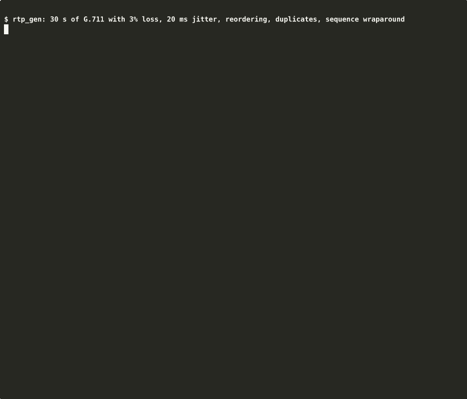

# rtp-scope

[](https://github.com/Sayanta-Claus/rtp-scope/actions/workflows/ci.yml)

RTP packet analyzer and jitter-buffer simulator for pcap files, in C++17 with no dependencies.

Topics: `rtp` `pcap` `cpp17` `networking` `voip` `jitter-buffer`

It has two tools:

- `rtp_scope` reads a `.pcap`, finds the RTP streams and reports loss, duplicates, reordering and jitter (text or JSON). It can also replay a stream through a fixed and an adaptive jitter buffer.
- `rtp_gen` makes synthetic RTP captures (loss, jitter, reordering, duplicates, sequence wraparound) and writes a ground-truth file with the exact counts, so the analyzer can be checked against known answers.

I wrote it to learn RTP from the bytes up. Headers are parsed by hand, byte by byte, with every read bounds-checked. Only the standard library is used.

## Build

Needs GCC or Clang with C++17, and CMake 3.16+, on Linux.

```
cmake -S . -B build && cmake --build build -j
ctest --test-dir build --output-on-failure

# with AddressSanitizer + UBSan
cmake -S . -B build-san -DSANITIZE=ON -DCMAKE_BUILD_TYPE=Debug
cmake --build build-san -j && ctest --test-dir build-san --output-on-failure
```

## Usage

```
build/rtp_gen --out demo.pcap --duration 30 --seed 42 --loss 0.03 --jitter-ms 20 \
              --jitter-dist normal --reorder 0.01 --duplicate 0.01 --wrap
build/rtp_scope demo.pcap                 # text report
build/rtp_scope --json demo.pcap
build/rtp_scope --simulate demo.pcap      # adds the jitter-buffer comparison (--fixed-delay MS, --k K)
build/rtp_scope --sweep demo.pcap         # CSV: strategy,avg_latency_ms,late_or_lost_pct
build/rtp_scope --clock-rate 96=90000 video.pcap
```

`rtp_gen --help` lists the rest (`--start-seq`, `--vlan`, `--sll`, `--nano`, `--big-endian`, talkspurts...). Exit codes: 0 ok, 1 runtime error, 2 bad usage.



The same run as text (`scripts/demo.sh`; the recording is `results/demo.cast`, and the GIF was made from it with `agg`):

```
$ cat demo.pcap.truth
packets_sent=1500
packets_dropped=31
packets_duplicated=9
packets_reordered=13

$ rtp_scope demo.pcap
rtp-scope: demo.pcap
  link type          : Ethernet (1), microsecond timestamps
  frames in capture  : 1478
  RTP / RTCP         : 1478 / 0
  non-RTP UDP        : 0
  non-IPv4 / non-UDP : 0 / 0
  IPv4 fragments     : 0 (skipped)
  malformed          : 0 (network 0, rtp 0)

streams: 1

 #  source                destination           SSRC       PT         packets    dur(s)      kbps
 0  10.0.0.1:5004         10.0.0.2:5004         0x11223344 0 PCMU        1478    30.005     67.78

 #  ext.highest  expected   lost   loss%   dup   ooo jitter(ts) jitter(ms)
 0        66999      1500     31    2.07     9    13      94.54     11.817

$ rtp_scope --simulate demo.pcap
 strategy           played   late   lost  late+lost %  avg lat (ms)  max lat (ms)
 fixed-60ms           1469      0     31         2.07         54.01         85.25
 adaptive-k4          1461      8     31         2.60         39.09         70.58
```

31 lost, 9 duplicates and 13 out of order are the same numbers as in the truth file. The highest sequence number, 66999, is 65500 + 1499, so the 16-bit counter wrapped once.

## How it works

Packets go through `pcap_reader` -> `net_decode` (Ethernet with VLAN tags, Linux SLL or BSD loopback, IPv4, UDP) -> `classify` (RTP / RTCP / other) -> per-stream stats -> report or jitter-buffer simulation.

- **pcap**: classic format, both byte orders, microsecond and nanosecond timestamps. Records are streamed, so memory doesn't grow with the file. Link types Ethernet, Linux SLL and BSD loopback are supported; others are rejected with an error.
- **Bad input** is counted, not fatal. Every frame ends up in exactly one counter.
- **RTP detection** is a heuristic. A packet must have version 2, not be an RTCP type, and its CSRC list, extension and padding must fit. Real captures showed that isn't enough (DNS and NetBIOS packets often pass), so two more rules apply: UDP ports of other well-known protocols (53, 67/68, 123, 137/138, 161/162, 514, 1900, 5353, 5355) are never RTP, and a stream is only reported once it has two packets with consecutive sequence numbers (the "probation" idea from RFC 3550 A.1). Packets that looked like RTP but never formed a sequence are counted as non-RTP and shown in the report. RTCP (types 200-204) is only counted.
- **Loss** follows RFC 3550 appendix A.1. The 16-bit sequence number is extended to a counter that survives wraparound, and a bitmap tells duplicates from late packets. `expected = highest - base + 1` and `lost = expected - unique received`, never below 0. The JSON also has `lost_rfc_signed`, which counts duplicates as received and can go negative, like the RFC and Wireshark.
- **Jitter** is section 6.4.1: `J += (|D| - J) / 16`, where D is the change in packet spacing between arrival and RTP timestamp. It is shown in timestamp units and in ms. Default clock rates: 8000 for PCMU/PCMA/G.722, 90000 for video types, 48000 for dynamic payload types (so Opus works). Change them with `--clock-rate PT=HZ`.
- **Jitter buffer**: a packet is on time if its network transit is at most the playout delay D, and late (dropped) otherwise. The fixed buffer uses a constant D. The adaptive one follows Ramjee et al. (1994): a moving average of transit time plus k times its deviation. It jumps to the new delay at talkspurt starts (marker bit or a gap over 100 ms) and otherwise moves at most 0.5 ms per packet.

## Results

All numbers below come from running the commands shown, on an i5-12450H under WSL2 (Ubuntu 22.04, GCC 11.4). Raw output is in `results/`.

### Validation against ground truth

```
scripts/validate.sh --count 120 --bin build | tee results/validation.txt
```

`rtp_gen` was run 120 times with different seeds, loss, jitter, reordering, duplicates, sequence starts (including wraparound) and pcap variants. In each case `rtp_scope` had to match the truth file exactly on packets received, unique, expected, lost, duplicates, reordered and highest sequence number. Result: **120/120 traces matched**.

Two definitions matter here. "Reordered" means a packet that arrives after one with a higher sequence number; the generator makes these by swapping neighbours, so one swap is one reordered packet. "Lost" means missing between the lowest and highest sequence number received, since drops at the very start or end can't be seen by a receiver (the truth file has both `packets_dropped` and `packets_lost`). This check is partly my generator agreeing with my analyzer, which is why the Wireshark comparison below is useful.

The first run gave 117/120. All three failures were the script passing `--vlan` and `--sll` together, which `rtp_gen` refuses. I fixed the script.

### Speed and memory

```
cmake --build build --target bench | tee results/benchmark.txt
```

Median of 5 runs on 1,000,000 generated packets (991,859 in the file after 1% loss, 228 MB), built with `-O2`:

| stage | packets/sec | MB/s |
|---|---:|---:|
| parse only | 5,492,337 | 1,263 |
| parse + analysis | 5,317,374 | 1,223 |

Peak memory was 4,756 kB. The file sits in the page cache, so this is CPU speed, not disk. Parse-only and parse + analysis are within noise of each other.

This laptop is not a steady benchmark machine: an earlier session measured about 11M packets/sec for what was then the same parsing code. I built the previous commit next to the current one and ran both back to back; they came out the same (6-7M packets/sec at that moment), so the change is the machine, not the code. Treat the numbers as the right order of magnitude, not as exact. WSL2 also means bare-metal numbers will differ.

### Robustness

```
cmake -S . -B build-san -DSANITIZE=ON -DCMAKE_BUILD_TYPE=Debug && cmake --build build-san -j
scripts/fuzz.sh --bin build-san --count 1000 | tee results/robustness.txt
build-san/test_mutation
```

1000 corrupted captures (bit flips, truncation, overwritten bytes, extreme field values; fixed seeds) were run through `rtp_scope` built with the sanitizers: 809 analysed, 191 rejected with an error, no crashes, hangs or sanitizer reports. (`--simulate` exits with an error when a damaged file has no usable stream, which is most of the rejections.) `test_mutation` does 3000 more in-process (2649 analysed, 351 rejected), also clean. This is random mutation with fixed seeds, not coverage-guided fuzzing.

### Real captures

The tests above all use traffic from `rtp_gen`, so I also ran three public captures. I haven't committed them (they're git-ignored). The [Wireshark SampleCaptures wiki](https://wiki.wireshark.org/SampleCaptures) lists public captures like these; check the terms there before reusing any. I used `MagicJack-_short_call.pcap` (two PCMU directions of a VoIP call), `h263-over-rtp.pcap` (H.263 video, loopback link type, with SIP on port 5060) and `aaa.pcap` (a short PCMA stream among DNS and NetBIOS traffic).

```
python3 scripts/crosscheck_pcap.py --bin build captures/*.pcap | tee results/real-captures.txt
```

| capture | stream | packets (tshark / rtp_scope) | lost | mean jitter ms | max jitter ms |
|---|---|---|---|---|---|
| MagicJack | .10:49154 -> 216.234.64.16:54550, PCMU | 642 / 642 | 0 / 0 | 12.234 / 12.234 | 12.838 / 12.838 |
| MagicJack | 216.234.64.16:54550 -> .10:49154, PCMU | 626 / 626 | 0 / 0 | 0.229 / 0.229 | 0.832 / 0.832 |
| aaa | 192.168.1.2:30000 -> 212.242.33.36:40392, PCMA | 9 / 9 | 0 / 0 | 5.646 / 5.646 | 7.799 / 7.799 |
| h263-over-rtp | 192.168.6.199:57128 -> :32976, H.263 | 45 / 45 | 0 / 0 | 15.505 / 17.659 | 32.186 / 32.187 |

Both tools find the same 4 streams and agree on packets and loss. Mean and max jitter agree exactly except for the H.263 mean. Running `rtp_scope` on the files had also shown some things my synthetic tests couldn't:

- The first version reported DNS and NetBIOS packets as RTP "streams" (2 extra in MagicJack, 7 in `aaa.pcap`, plus 49 "malformed RTP" that were DNS). That led to the port list and sequence-number check described above.
- `h263-over-rtp.pcap` has link type 0 (loopback), which was rejected, so I added it.

The H.263 mean jitter is unexplained. The max matches to three decimals, so the per-packet jitter values are right; only the averaging differs (tshark 15.505, mine 17.659, a plain average of the same per-packet values). Video frames are split into several packets with the same RTP timestamp, which none of my other test streams do. I tried a few other averaging formulas and none reproduced tshark's number, so I don't know what it does there. Wireshark's own reading of this file also used `-o rtp.heuristic_rtp:TRUE`, so this checks the numbers, not the detection.

### Jitter buffer sweep

```
scripts/make_sweep.sh --bin build
```

Trace: 120 s, 2% loss, normal jitter (25 ms), 0.5% reordering, talkspurts of 3 s with 1 s gaps.


| strategy | avg latency (ms) | late or lost % |
|---|---:|---:|
| fixed 0 ms | 4.7 | 77.16 |
| fixed 20 ms | 15.1 | 27.71 |
| fixed 40 ms | 29.9 | 6.49 |
| fixed 60 ms | 48.4 | 2.49 |
| fixed 100 ms | 88.1 | 2.02 |
| adaptive k=2 | 26.1 | 9.80 |
| adaptive k=4 | 46.5 | 2.62 |
| adaptive k=8 | 92.0 | 2.02 |

The floor at about 2% is the packets that never arrived, which no buffer can fix. The adaptive buffer lands on about the same curve as the fixed one. It doesn't beat the best fixed delay, but you don't have to pick the delay yourself. All rows are in `results/sweep.csv`.

### Wireshark comparison

```
scripts/crosscheck_tshark.sh --bin build | tee results/crosscheck.txt
```

Same generated files through `tshark -z rtp,streams` (3.6.2) and `rtp_scope`:

| scenario | packets | lost | mean jitter ms | max jitter ms |
|---|---|---|---|---|
| clean | 1000 / 1000 | 0 / 0 | 0.000 / 0.000 | 0.000 / 0.000 |
| 5% loss | 953 / 953 | 47 / 47 | 0.000 / 0.000 | 0.000 / 0.000 |
| loss + jitter 15 ms | 964 / 964 | 36 / 36 | 9.308 / 9.308 | 13.427 / 13.427 |
| uniform jitter 40 ms | 1000 / 1000 | 0 / 0 | 12.231 / 12.231 | 16.048 / 16.048 |
| wraparound + loss | 969 / 969 | 31 / 31 | 3.231 / 3.231 | 5.097 / 5.097 |
| reorder + dup + loss | 1027 / 1027 | -27 / -27 | 6.189 / 6.515 | 18.380 / 18.623 |
| payload type 111 | 980 / 980 | 20 / 20 | 0.000 / 11.574 | 0.000 / 18.113 |

Each cell is tshark / rtp_scope. Packets and loss agree everywhere, and jitter agrees to three decimals except in two rows:

- With duplicates, Wireshark includes them in the jitter estimate and I don't (a duplicate has the same timestamp, so it isn't a new delay sample). I checked that this is the whole difference by turning duplicates on in rtp_scope for a test: it then matched tshark to four decimals. I left them out on purpose.
- For payload type 111, tshark shows 0 because without SDP it doesn't know the clock rate. rtp_scope assumes 48000 Hz for dynamic types, so its number is only as good as that guess.

tshark was told to decode UDP port 5004 as RTP, so this checks the numbers, not the RTP detection.

## Choices I made

- Bitrate counts RTP header + payload over (last arrival - first arrival), not UDP/IP/Ethernet overhead.
- Streams are keyed by source/destination address and port plus SSRC. The first packet's payload type sets the clock rate.
- A frame cut short by the capture snaplen counts as malformed.
- In `rtp_gen`, "normal" jitter is `|N(0, J)|` and "uniform" is `U[0, J]`, since delay can't be negative. Generated traffic passes through a FIFO path, so jitter alone never reorders; reordering is a separate option.
- `--simulate` and `--sweep` use the stream with the most packets, or `--stream N`.

## Limits

- IPv4 only, classic pcap only (no pcapng), Ethernet, Linux SLL and BSD loopback link types only. Fragments are skipped, not reassembled.
- RTP detection is a heuristic. A stream with fewer than two consecutive packets is not reported, and RTP on one of the excluded well-known ports (for example 53 or 137) would be missed. There's no SDP handling, so dynamic payload types rely on defaults or `--clock-rate`.
- RTCP is not parsed.
- The jitter-buffer model anchors playout to the first packet and ignores clock drift and loss concealment.
- Reordering deeper than 100 packets is treated as a sequence jump (A.1 limits).
- Not done yet: the GitHub Actions workflow hasn't run, and everything was tested on one machine (WSL2, GCC 11 and Clang 14). Real traffic was limited to three small public captures, none with loss or reordering.

## Layout

```
src/      library: parsing, stats, jitter buffer, generator
tools/    rtp_scope, rtp_gen, pcap_mutate
tests/    small test harness, 13 test programs + cli_smoke.sh (14 ctest tests)
bench/    benchmark
scripts/  validate, fuzz, bench, sweep + plot, tshark comparison (synthetic and real), demo
results/  saved output of the commands above
docs/     MODULES.md
```

## License

MIT, see [LICENSE](LICENSE).
