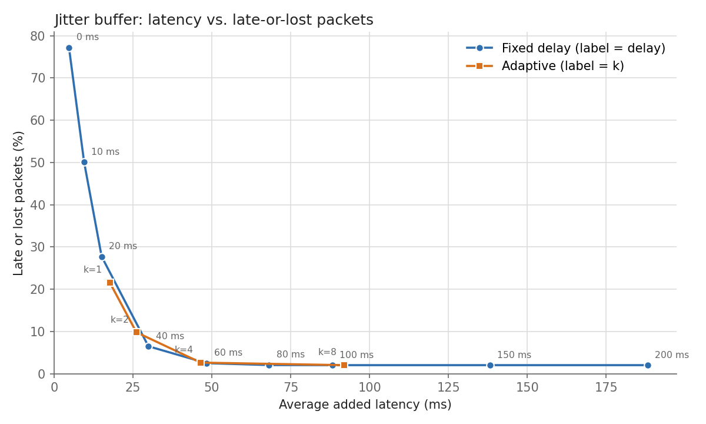

# rtp-scope

[](https://github.com/Sayanta-Claus/rtp-scope/actions/workflows/ci.yml)

A zero-dependency C++17 toolkit for looking at RTP (Real-time Transport Protocol, RFC 3550) traffic:

- **`rtp_scope`**: reads a `.pcap`, finds the RTP streams and reports packet loss, duplicates, reordering and interarrival jitter, as a text table or JSON. It can also replay a stream through fixed and adaptive **jitter buffers** and show the latency vs. late-packet trade-off.
- **`rtp_gen`**: generates deterministic synthetic RTP captures (loss, jitter, reordering, duplicates, sequence wraparound) together with a *ground-truth file* saying exactly what it did to the traffic, so the analyzer can be tested against known answers.

I built it to understand real-time media transport from the bytes up: every header field is parsed by hand with explicit endianness, every read is bounds-checked, and every claim in this README is backed by a command you can re-run (see [Results](#results)). The standard library is the only dependency. A module-by-module walkthrough with interview-style Q&A is in [docs/MODULES.md](docs/MODULES.md).

## Build and run

Needs a C++17 compiler (GCC or Clang) and CMake 3.16+, on Linux.

```bash
cmake -S . -B build && cmake --build build -j
ctest --test-dir build --output-on-failure          # 13 tests (12 C++ programs + a CLI smoke script)

# sanitizer build (AddressSanitizer + UndefinedBehaviorSanitizer)
cmake -S . -B build-san -DSANITIZE=ON -DCMAKE_BUILD_TYPE=Debug
cmake --build build-san -j && ctest --test-dir build-san --output-on-failure
```

All code builds with `-Wall -Wextra -Wpedantic -Werror`.

```bash
build/rtp_gen --out demo.pcap --duration 30 --seed 42 --loss 0.03 --jitter-ms 20 \
              --jitter-dist normal --reorder 0.01 --duplicate 0.01 --wrap
build/rtp_scope demo.pcap                 # text report
build/rtp_scope --json demo.pcap          # machine-readable
build/rtp_scope --simulate demo.pcap      # + jitter-buffer comparison (--fixed-delay MS, --k K)
build/rtp_scope --sweep demo.pcap         # CSV: strategy,avg_latency_ms,late_or_lost_pct
build/rtp_scope --clock-rate 96=90000 video.pcap   # override a payload type's clock rate
```

Exit codes: 0 ok, 1 runtime error (unreadable file, unsupported link type, ...), 2 usage error. `rtp_gen --help` lists the generator options (`--start-seq`, `--wrap`, `--vlan`, `--sll`, `--nano`, `--big-endian`, talkspurts, ...).

### Example output

Real output of `scripts/demo.sh` (recorded in [results/demo.cast](results/demo.cast); play it with `asciinema play results/demo.cast`):

```
$ rtp_gen --out demo.pcap --duration 30 --seed 42 --loss 0.03 --jitter-ms 20 --jitter-dist normal --reorder 0.01 --duplicate 0.01 --wrap
$ cat demo.pcap.truth
packets_sent=1500
packets_dropped=31
packets_duplicated=9
packets_reordered=13

$ rtp_scope demo.pcap
rtp-scope: demo.pcap
  link type          : Ethernet (1), microsecond timestamps
  frames in capture  : 1478
  RTP / RTCP         : 1478 / 0
  non-RTP UDP        : 0
  non-IPv4 / non-UDP : 0 / 0
  IPv4 fragments     : 0 (skipped)
  malformed          : 0 (network 0, rtp 0)

streams: 1

 #  source                destination           SSRC       PT         packets    dur(s)      kbps
 0  10.0.0.1:5004         10.0.0.2:5004         0x11223344 0 PCMU        1478    30.005     67.78

 #  ext.highest  expected   lost   loss%   dup   ooo jitter(ts) jitter(ms)
 0        66999      1500     31    2.07     9    13      94.54     11.817

$ rtp_scope --simulate demo.pcap
 strategy           played   late   lost  late+lost %  avg lat (ms)  max lat (ms)
 fixed-60ms           1469      0     31         2.07         54.01         85.25
 adaptive-k4          1461      8     31         2.60         39.09         70.58
```

The analyzer's 31 lost / 9 duplicate / 13 out-of-order packets and the highest extended sequence number (66999 = 65500 + 1499, i.e. the 16-bit sequence number wrapped once) equal the generator's ground truth.

## Design

### Parsing pipeline

```
pcap file -> pcap_reader -> net_decode (Ethernet/VLAN/SLL, IPv4, UDP) -> classify (RTP/RTCP/other)
          -> stream_stats (seq_tracker + jitter) -> report / jitter_buffer
```

- **pcap**: classic format, all four magic numbers (big/little endian × microsecond/nanosecond). Records are streamed through one reusable buffer, so memory does not grow with file size. Link types Ethernet (1) and Linux cooked SLL (113) are accepted; others are rejected with a clear error.
- **Network headers**: Ethernet II with any number of 802.1Q/802.1ad tags, IPv4 with the real header length from IHL, UDP. IPv4 fragments are skipped and counted.
- **RTP header** (RFC 3550 §5.1): version must be 2; padding, extension and CSRC list are handled when computing the payload length.
- **Safety**: all reads go through `ByteReader`, which checks bounds and assembles integers byte by byte (no struct overlays, no host-endianness assumptions). Malformed or truncated input is *counted*, never a crash. Every frame lands in exactly one counter, so the counters add up to the number of frames.
- **RTP detection** is heuristic: UDP payload with version 2, not an RTCP packet type (200-204 counted as RTCP, 192-207 otherwise excluded), and a header whose CSRC/extension/padding fit the packet length. Version-2-looking packets with impossible lengths are reported as malformed.

### Loss, duplicates and reordering (RFC 3550 Appendix A.1)

The 16-bit sequence number is extended to a 64-bit counter (`cycles * 65536 + seq`) so that wraparound does not break loss counting. `udelta = (uint16)(seq - max_seq)` classifies each packet: small forward step (in order, gap = loss; a numerically smaller `seq` means a wrap), a step just behind the highest number (late or duplicate), or an implausible jump (rejected unless the next packet continues from it, in which case the source restarted). A 65536-bit "seen" ring tells duplicates from reordered packets. Then

```
expected = extended highest seq - base seq + 1
lost     = expected - unique packets received      (clamped at 0; duplicates counted separately)
```

JSON also carries `lost_rfc_signed = expected - received-including-duplicates`, which can be negative exactly as in RFC 3550 §6.4.1 (this is the number Wireshark prints).

### Jitter (RFC 3550 §6.4.1)

For consecutive packets, `D = (arrival_i - arrival_{i-1}) - (timestamp_i - timestamp_{i-1})` in RTP timestamp units, then `J += (|D| - J) / 16`. The 1/16 gain is a low-pass filter: single spikes move J a little, sustained changes are tracked within tens of packets. Timestamp differences are signed 32-bit, so the 2^32 timestamp wrap is harmless. Reported in timestamp units and in milliseconds (divided by the clock rate).

Clock rate defaults: PCMU/PCMA 8000, G.722 8000 (its RTP clock, not its 16 kHz sampling rate), L16 44100, video static types 90000, **dynamic payload types 48000** (e.g. Opus). Override with `--clock-rate PT=HZ`.

### Jitter-buffer simulation

A packet's *transit* is `arrival - media time` (media time from the unwrapped RTP timestamp, both relative to the first packet). A buffer with playout delay `D` plays a packet at `media time + D`: on time if `transit <= D` (it waits `D - transit` in the buffer), otherwise it is late and discarded. "Added latency" is that waiting time.

- **Fixed**: constant `D` (`--fixed-delay`, default 60 ms).
- **Adaptive** (Ramjee et al., INFOCOM 1994, algorithm 1): keep an EWMA of the transit `d` and of its deviation `v` (weight 0.998, bias-corrected during the first samples), target `D = d + k*v` (`--k`, default 4). `D` jumps to the target at **talkspurt boundaries** (marker bit, or a >100 ms gap in media time), where changing the delay is inaudible, and otherwise creeps towards it by at most 0.5 ms per packet. It stays at the initial delay for the first 20 packets.

`--sweep` runs fixed delays 0-200 ms and the adaptive buffer for k in {1, 2, 4, 8} and prints a CSV.

## Results

Everything below came from running the listed commands on one machine (Intel Core i5-12450H, 12 logical cores, 7.8 GiB RAM, WSL2 Ubuntu 22.04, GCC 11.4.0). Raw outputs are in [results/](results/).

### 1. Ground-truth validation: 120/120 traces matched

```bash
scripts/validate.sh --count 120 --bin build | tee results/validation.txt
```

`rtp_gen` was run over 120 combinations of seed, loss (0-30%), reordering (0-20%), duplication (0-15%), jitter (0-60 ms, uniform and normal), sequence start (arbitrary, and wraparound), pcap flavour (nanosecond, big-endian, VLAN, SLL), talkspurts and RTP-timestamp wrap. For each, `rtp_scope --json` must equal the ground-truth file **exactly** on packets received, unique packets, expected, lost, duplicates, reordered and extended highest sequence number: `120/120 traces matched` ([results/validation.txt](results/validation.txt)). The same check at library level runs in `ctest` as `test_e2e`.

*What "reordered" means, and what "lost" means.* These are definitions, so the check is only meaningful if they are stated:

- **Reordered** = a packet that arrives after a packet with a higher sequence number (what a receiver can observe). The generator reorders by swapping a packet with the next delivered one, so one swap = exactly one reordered packet. Jitter by itself never reorders in the generator (its path is FIFO), which keeps the count unambiguous. Real networks can reorder by more than one position; the analyzer counts those packets once each as well.
- **Lost** = packets missing *between* the lowest and highest sequence number received. Packets dropped before the first or after the last delivered packet are invisible to any receiver, so the ground truth reports both `packets_dropped` (everything) and `packets_lost` (observable), and the analyzer is checked against the observable one.
- The validation is partly an agreement between my generator's model and my analyzer's definitions; the independent check is the Wireshark comparison below.

During this work the first run showed 117/120. The 3 failures were all the script asking `rtp_gen` for `--vlan` and `--sll` together, which the generator correctly rejects; the analyzer had matched every trace it was given. The script now avoids that combination.

### 2. Throughput and memory

```bash
cmake -S . -B build && cmake --build build --target bench | tee results/benchmark.txt
```

Median of 5 runs on a 1,000,000-packet synthetic capture (991,859 packets / 228 MB in the file after 1% loss, plus duplicates), compiled with `-O2 -DNDEBUG`:

| Stage | packets/sec | MB/s |
|---|---:|---:|
| parse only (pcap + Ethernet/IP/UDP + RTP header) | 10,313,912 | 2,372 |
| parse + full analysis (sequence tracking, jitter, stats) | 11,191,082 | 2,574 |

Peak memory (median): **4,740 kB** (`VmHWM`), independent of capture size because records are streamed. The capture is in the OS page cache, so this measures the CPU-bound pipeline, not the disk. The "parse only" figure being lower than "parse + analysis" is run-to-run noise (the two stages differ by a few percent; the statistics work is tiny next to header parsing; the parse pass also runs first in each process); do not read it as analysis being free. Runs were on WSL2, so absolute numbers on bare metal will differ. Full output with machine info: [results/benchmark.txt](results/benchmark.txt).

### 3. Robustness: no crashes, hangs or sanitizer reports

```bash
cmake -S . -B build-san -DSANITIZE=ON -DCMAKE_BUILD_TYPE=Debug && cmake --build build-san -j
scripts/fuzz.sh --bin build-san --count 1000 | tee results/robustness.txt
build-san/test_mutation
```

- **Binary level** (`scripts/fuzz.sh`): 1000 mutated captures (bit flips, byte overwrites, truncation, chunk delete/insert, extreme field values; fixed seeds 1-1000) through the real `rtp_scope` built with ASan+UBSan, every third also with `--simulate`: 849 analysed (exit 0), 151 rejected with an error message (exit 1), **0 crashes, hangs (10 s timeout) or sanitizer reports**.
- **In-process** (`test_mutation`, also part of `ctest`): 3000 mutations of four corpus files through the analyzer, both report formats and both jitter-buffer simulations: 2643 analysed, 357 rejected cleanly, 0 failures, slowest case 9.9 ms.

([results/robustness.txt](results/robustness.txt).) This is a bounded mutation test with fixed seeds, not coverage-guided fuzzing, so it demonstrates robustness against random damage but is not a proof.

### 4. Jitter-buffer sweep

```bash
scripts/make_sweep.sh --bin build     # writes results/sweep.csv and results/sweep.png
```

Trace: 120 s, 2% loss, normal jitter (scale 25 ms), 0.5% reordering, talkspurts of 3 s speech and 1 s silence, seed 3.



| strategy | avg latency (ms) | late-or-lost % |
|---|---:|---:|
| fixed 0 ms | 4.7 | 77.16 |
| fixed 20 ms | 15.1 | 27.71 |
| fixed 40 ms | 29.9 | 6.49 |
| fixed 60 ms | 48.4 | 2.49 |
| fixed 100 ms | 88.1 | 2.02 |
| adaptive k=2 | 26.1 | 9.80 |
| adaptive k=4 | 46.5 | 2.62 |
| adaptive k=8 | 92.0 | 2.02 |

(all rows: [results/sweep.csv](results/sweep.csv)). The curve flattens at about 2.0%, which is the packets that never arrived: no buffer can recover those. On this trace the adaptive buffer sits on essentially the same latency/loss curve as the fixed one (k=4 is 1.9 ms below fixed 60 ms in latency and 0.13 points higher in loss); its advantage is that it finds a sensible operating point by itself instead of needing the right delay chosen in advance, not that it beats the best fixed delay. `late+lost` percentages are fractions of the *expected* packets.

### 5. Wireshark cross-check (tshark 3.6.2)

```bash
scripts/crosscheck_tshark.sh --bin build | tee results/crosscheck.txt
```

| scenario | packets (tshark / rtp_scope) | lost (tshark / rtp_scope) | mean jitter ms (tshark / rtp_scope) | max jitter ms (tshark / rtp_scope) |
|---|---|---|---|---|
| clean network | 1000 / 1000 | 0 / 0 | 0.000 / 0.000 | 0.000 / 0.000 |
| 5% loss | 953 / 953 | 47 / 47 | 0.000 / 0.000 | 0.000 / 0.000 |
| loss + normal jitter 15 ms | 964 / 964 | 36 / 36 | 9.308 / 9.308 | 13.427 / 13.427 |
| uniform jitter 40 ms | 1000 / 1000 | 0 / 0 | 12.231 / 12.231 | 16.048 / 16.048 |
| sequence wraparound + loss | 969 / 969 | 31 / 31 | 3.231 / 3.231 | 5.097 / 5.097 |
| reorder 5% + dup 5% + loss | 1027 / 1027 | -27 / -27 | 6.189 / 6.515 | 18.380 / 18.623 |
| Opus-like PT 111 (48 kHz) | 980 / 980 | 20 / 20 | 0.000 / 11.574 | 0.000 / 18.113 |

Packet counts and loss agree in every scenario (rtp_scope's column is `lost_rfc_signed`, the RFC-style value that can be negative; for the duplicate scenario both tools print -27). Mean and max jitter agree to three decimals whenever the stream has no duplicates. The two differences are understood:

- **Duplicates.** Wireshark feeds duplicate packets into the jitter estimate; rtp_scope does not (a duplicate carries the same timestamp, so it is not a new delay measurement). I checked this explanation instead of assuming it: reordering alone matches exactly, and temporarily including duplicates in rtp_scope's jitter reproduced tshark's 6.195 / 18.634 (and 3.138 / 4.520 for a duplicates-only trace) to four decimals. I kept the exclusion as a deliberate choice.
- **Dynamic payload type 111.** tshark prints 0 jitter because without signalling (SDP) it does not know the clock rate of a dynamic payload type; rtp_scope assumes 48000 Hz for dynamic types (override with `--clock-rate`), so it can compute a value. That value is only as right as the assumption.

Both tools were given the same files, but tshark was run with `-d udp.port==5004,rtp`, so this checks the analysis, not the RTP-detection heuristic.

## Choices where the spec left room

- **Bitrate** = RTP bytes (header + payload) × 8 / (last arrival − first arrival); UDP/IP/Ethernet overhead excluded; a single packet gives 0.
- **Streams** are keyed by (src ip, src port, dst ip, dst port, SSRC). The first packet's payload type fixes the clock rate; a later payload-type change is flagged with `*`, not split.
- **A.1 probation** (requiring consecutive packets before trusting a new source) is omitted: streams are already separated by SSRC, and probation would discard the first real packets.
- **A frame cut short by the capture snaplen** (IP total length larger than the captured bytes) counts as malformed, because RTP length checks on it would be guesses.
- **RTCP** is only recognised (types 200-204) and counted; no RTCP content is parsed.
- `--simulate` / `--sweep` use one stream: the one with most packets, or `--stream N`.
- The generator's "normal" jitter is `|N(0, J)|` (a half-normal added to the base delay) and "uniform" is `U[0, J]`, because a delay cannot be negative.

## Limitations

- IPv4 only (no IPv6), classic pcap only (no pcapng), link types Ethernet and Linux SLL only.
- IPv4 fragments are skipped, not reassembled.
- RTP detection is heuristic (version 2, plausible type, consistent lengths): random UDP can occasionally look like RTP, and there is no SDP/signalling awareness, so dynamic payload types rely on defaults or `--clock-rate`.
- RTCP is not parsed (no receiver reports, no round-trip time, no sender-side NTP/RTP mapping).
- The jitter-buffer model assumes a single constant offset between sender and receiver clocks and anchors playout to the first packet that arrived; it does not model clock drift, packet-loss concealment, or codec frame durations.
- Sequence tracking follows RFC 3550 A.1's thresholds (3000 dropout, 100 misorder); reordering deeper than 100 packets is treated as a discontinuity.

## What has not been verified

- **GitHub Actions**: the workflow ([.github/workflows/ci.yml](.github/workflows/ci.yml)) has not run yet because the repository has not been pushed from this machine; the badge will show a status after the first push. The same commands pass locally.
- **Platforms**: everything was built and measured on one Linux (WSL2) machine with GCC 11.4 and Clang 14; no macOS, Windows or other compiler versions.
- **Real-world captures**: all validation uses traffic made by `rtp_gen` (and tshark's reading of it). I have not run it on captures from a real VoIP call.

## Repository layout

```
src/        core library (byte_reader, pcap_reader, net_decode, rtp_header, classify, seq_tracker,
            jitter, clock_rate, stream_stats, analyzer, report, jitter_buffer, traffic_model,
            trace_gen, pcap_writer, cli_args)
tools/      rtp_scope, rtp_gen, pcap_mutate (mutation helper for the fuzz script)
tests/      self-written test harness; 12 C++ test programs + cli_smoke.sh = 13 ctest tests
bench/      throughput benchmark        scripts/  validate, fuzz, bench, sweep/plot, tshark cross-check, demo
results/    saved outputs of the commands above        docs/MODULES.md  module guide with interview Q&A
```
